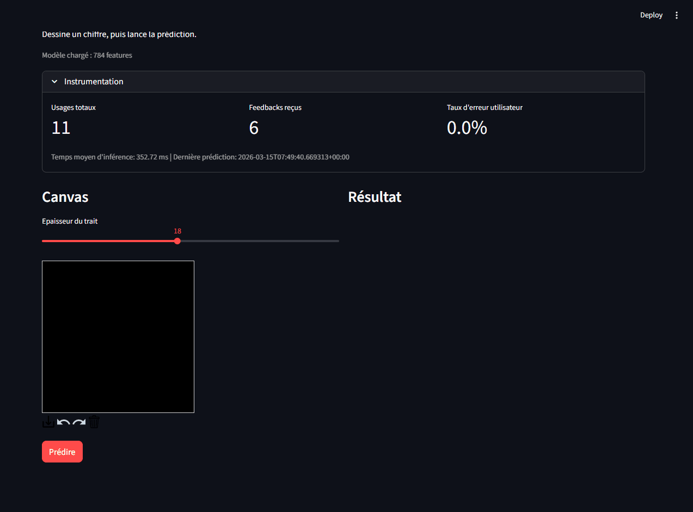

# MNIST Express

MNIST Express est une mini-application pédagogique qui explore un pipeline **Machine Learning complet** autour du classifieur **k-Nearest Neighbors (k-NN)** appliqué au dataset **MNIST (28×28)**.

Le projet montre comment passer de :

dataset brut → entraînement → benchmarking → optimisation d’inférence → application interactive.

L'utilisateur peut **dessiner un chiffre à la main et obtenir une prédiction en temps réel** via une interface Streamlit.



## Demo

Application Streamlit :

https://mnist-express.streamlit.app/

L'utilisateur peut dessiner un chiffre sur un canvas et obtenir immédiatement :
- la **classe prédite**
- la **confiance du modèle**
- les **top-k prédictions**
- le **temps d'inférence**

## Vue d'ensemble

Le projet couvre un pipeline ML complet :
1. Chargement du dataset MNIST
2. Pré-traitement des images dessinées par l'utilisateur
3. Entraînement d'un modèle **k-NN**
4. Benchmark des différentes stratégies d'indexation
5. Optimisation des performances d'inférence
6. Interface interactive Streamlit
7. Monitoring simple de l'utilisation de l'application

L'objectif du projet est **pédagogique** : comprendre concrètement les implications des choix d'architecture dans un pipeline ML.

## Fonctionnalités clés

### Entraînement k-NN
- classification d'images MNIST (784 features)
- calcul des métriques :
    - accuracy
    - recall par classe
    - confusion matrix

### Benchmark d'algorithmes
Comparaison des stratégies de recherche de voisins :
- `brute`
- `kd_tree`
- `ball_tree`

### Batching d'inférence
Optimisation du débit d'inférence en regroupant les prédictions par lots.

### Monitoring simple
Instrumentation minimale :
- compteur d'usages
- temps moyen d'inférence
- taux d'erreur utilisateur (feedback)

### Interface interactive
Application Streamlit permettant :
- de dessiner un chiffre
- d'obtenir la prédiction en temps réel
- d'observer les métriques du modèle

## Architecture

Structure principale du projet :

Le projet suit une architecture hexagonale (ports et adaptateurs) : voir [ADR-001](docs/adr/ADR-001-architecture-hexagonale.md).

```
mnist_express/
 ├── core/              # coeur, sans I/O
 |   ├── model.py       # objets du domaine (Prediction, UsageStats)
 |   ├── ports.py       # interfaces dont le coeur a besoin
 |   └── use_cases.py   # PredictDigit, RecordFeedback, GetUsageStats
 ├── adapters/          # implémentations des ports (joblib, JSON, horloge)
 ├── bootstrap.py       # racine de composition : assemble coeur et adaptateurs
 ├── config.py          # configuration globale
 ├── data.py            # chargement dataset MNIST
 ├── preprocessing.py   # pipeline de transformation des dessins
 ├── train.py           # entraînement et benchmark k-NN
 ├── inference.py       # prédiction batchée
 ├── metrics.py         # métriques et confusion matrix
 ├── monitoring.py      # façade de compatibilité (monitoring)
 └── persistence.py     # façade de compatibilité (sauvegarde des modèles)
```

Application interactive :

```
app/
 └── streamlit_app.py
```

Artefacts générés :

```
artifacts/
 ├── models/
 ├── metrics/
 └── monitoring/
```

## Benchmark Results

Un benchmark comparatif a été réalisé sur un sous-ensemble borné du dataset MNIST.

Comparaison des algorithmes k-NN :

Algorithm   Accuracy    Predict Time    QPS
brute       ~0.949      ~4.6 s          ~110
kd_tree     ~0.949      ~9.1 s          ~56
ball_tree   ~0.949      ~7.2 s          ~70

### Conclusion

Les trois algorithmes produisent **la même accuracy**, mais :
- `brute` est **le plus rapide**
- `kd_tree` et `ball_tree` n'apportent pas d'avantage dans cet espace de **784 dimensions**

Le modèle retenu par défaut est donc :

```
algorithm = "brute"
```

## Impact du batching d'inférence

Le batching améliore fortement le débit :

Batch size  Queries / sec
1           ~30
64          ~1100
256         ~1580
1024        ~1750

Le pipeline d'inférence utilise donc le **batching** pour améliorer les performances.

## Installation

Pré-requis
- Python <= 3.9
- pip

Installation :

```
pip install -r requirements.txt
```

## Entraînement

L'entraînement et le benchmark se lancent avec :

```
python run_train.py
```

Le script :
1. charge le dataset MNIST
2. exécute le benchmark `brute / kd_tree / ball_tree`
3. sélectionne le meilleur modèle
4. sauvegarde le modèle entraîné dans :

```
artifacts/models/model_knn_best.joblib
```

## Application Streamlit

Pour lancer l'interface interactive :

```
streamlit run app/streamlit_app.py
```

Fonctionnalités :
- canvas de dessin
- prédiction en temps réel
- affichage des probabilités
- métriques d'inférence
- instrumentation simple

## Monitoring

Le projet inclut une instrumentation légère :
- nombre total de prédictions
- temps moyen d'inférence
- nombre de feedbacks utilisateur
- taux d'erreur utilisateur

Les statistiques sont enregistrées dans :

```
artifacts/monitoring/usage_stats.json
```

## Evolution du projet

### v5 - Architecture hexagonale
- coeur isolé derrière des ports (modèle, statistiques d'usage)
- Streamlit réduit à un adaptateur d'interface
- tests de caractérisation écrits avant le refactor, inchangés après
- règle de dépendance vérifiée par un test

### v4 - Benchmark et instrumentation
- benchmark `brute / kd_tree / ball_tree`
- batching d'inférence
- monitoring simple
- logs structurés
- amélioration de l'architecture

### v3 - Pipeline digits
- pipeline canvas -> digits
- double modèle (standard + PCA)
- debug visuel

### v2 - Interface Streamlit
- canvas de dessin
- prédiction interactive
- top-k classes les plus probables

## License

Projet pédagogique libre d'utilisation