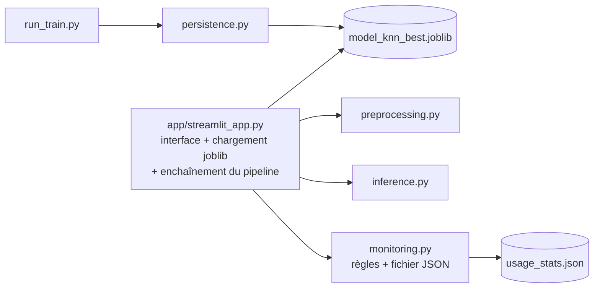
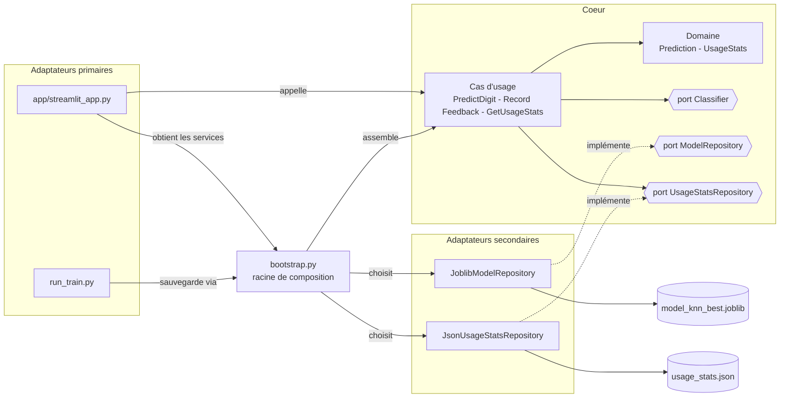

# ADR-001 : Isoler le coeur de l'application derrière des ports (architecture hexagonale)

## Contexte

Etat du code au 20/11/2026 (v4) :

- `docs/ARCHITECTURE.md` pose deux règles : `app/streamlit_app.py` ne fait que de l'interfacen et l'app "ne doit jamais charger un joblib directement". Le code ne les respecte pas.
- `streamlit_app.py` charge le modèle avec `joblib.load` et un chemin écrit en dur, qui double celui de `config.py`.
- `handle_prediction()`, dans le fichier Streamlit, enchaîne lui-même le pré-traitement, l'inférence, le résumé et le monitoring. Ce flux, le coeur de l'application, ne peut pas être testé sans Streamit.
- `monitoring.py` mêle les règles de calcul (compteurs, moyenne, taux d'erreurs) et l'écriture du fichier JSON.
- `persistence.py` existe mais l'app ne l'utilise pas, et `tests/test_persistence.py` est vide alors que `TEST_PLAN.md` prévoit des tests de persistance.

## Décision

Adopter une architecture hexagonale (ports et adaptateurs) :

- **Coeur** (`mnist_express/core/`, `preprocessing.py`, `inference.py`) : objets du domaine (`Prediction`, `UsageStats` et ses règles de mise à jour), ports secondaires (`Classifier`, `ModelRepository`, `UsageStatsRepository`, sous forme de `typing.Protocol`) et cas d'usage (`PredictDigit`, `RecordFeedback`, `GetUsageStats`). Le coeur n'importe ni Streamlit, ni joblib, ni aucun module d'accès aux fichiers.
- **Adaptateurs secondaires** (`mnist_express/adapters/`) : `JoblibModelRepository`, `JsonUsageStatsRepository`, horloge système.
- **Adaptateurs primaires** : `app/streamlit_app.py` (interface) et `run_train.py` (script d'entraînement).
- **Racine de composition** (`mnist_express/bootstrap.py`) : seul endroit qui choisit les adaptateurs et assemble les services.
- `persistence.py` et `monitoring.py` deviennent des façades de compatibilité vers les adaptateurs.

Méthode : écrire d'abord des tests de caractérisation qui figent le comportement existant, puis refactorer par petites étapes en gardant ces tests verts et inchangés.

## Statut

Acceptée, le 20/11/2026.

## Conséquences

|                      | Avant (v4)                                    | Après                                               |
|----------------------|-----------------------------------------------|-----------------------------------------------------|
| Chargement du modèle | `joblib.load` dans l'interface, chemin en dur | `JoblibModelRepository`, choisi dans `bootstrap.py` |
| Enchaînement prétraitement -> prédiction -> monitoring | `handle_prediction()` dans l'interface | `PredictDigit.execute()` dans le coeur |
| Règles de monitoring | mêlées à l'écriture du JSON | `UsageStats.record_prediction()` et `record_feedback()` |
| Tester le flux de prédiction | impossible sans Streamlit | adaptateur en mémoire, sans disque ni interface |
| Règle de dépendance | écrite dans la doc seulement | vérifiée par `tests/test_architecture.py` |
| Tests | 14 | 47 |

Positives :

- Les 10 tests de caractérisation (persistance, monitoring, flux de prédiction) passent avant et après le refactor sans avoir été modifiés : le comportement est conservé, y compris le format du fichier `usage_stats.json` de l'application déployée.
- Changer de stockage (base de données, registre de modèles) ne demande qu'un nouvel adaptateur et une ligne dans `bootstrap.py`.
- Le code respecte enfin la règle de `ARCHITECTURE.md` sur le chargement du modèle, et un test empêche d'y revenir.

Négatives et limites :

- Plus de fichiers et un niveau d'indirection de plus pour une petite application.
- Les façades `persistence.py` et `monitoring.py` sont à supprimer quand plus rien ne les utilise.
- Le côté entraînement n'est pas couvert : `train.py` écrit encore directement ses rapports dans `artifacts/metrics/`.
- Le contrat de versionnement des runs décriit dans `ARCHITECTURE.md` (`load_run`, `ModelBundle`) reste à implémenter. Le port `ModelRepository` est le bon endroit pour l'accueillir.